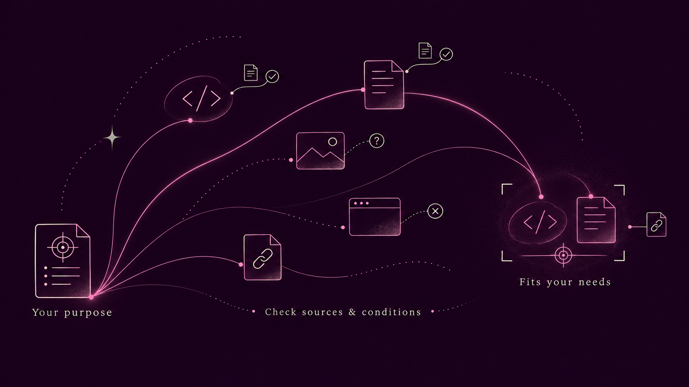

# 按实际用途搜集和筛选资源

[English](README.en.md) · [安装与使用](docs/INSTALL.md) · [完整案例](examples/subtitle-selection.md) · [验证记录](validation/README.md)

**找到能完成你的任务的资源，并说明为什么适合、还有什么没有确认。**

*从用途出发，核对来源与条件，再作选择。图中勾号表示资料支持，不表示实际运行过。*

一个用于 Codex 的工作方法 Skill。比较软件、开源项目、素材和文档时，先明确用途与限制，再核实实际内容、使用条件和证据。它提供可复用的判断方法；搜索、读取文件等能力由运行它的环境提供。

## 它会改变什么

“免费注册”“功能很多”“名字看起来相关”，都不能替代适用性判断。

| 普通候选描述 | 这个 Skill 继续检查什么 |
|---|---|
| 免费字幕工具 | 导出所需格式是否也免费？ |
| 支持 Mac | 是否支持用户实际的芯片和系统版本？ |
| 本地工具 | 原视频与识别过程是否真的留在本机？ |
| 支持双语 | 同一个 SRT 里有双语，还是分别输出两个文件？ |
| 已开源 | 实际提供什么？使用条件与许可是否明确？ |

## 看一个结果

**输入：** 在 Apple Silicon Mac 上，本地处理私密演示视频，免费导出中英双语 SRT。只用提供的资料，不安装、不联网。

以下产品均为虚构案例，不是真实推荐。

| 候选 | 结果 | 原因 |
|---|---|---|
| WindowCaption | 基于文档的条件推荐，未实测 | 需确认 macOS 13+；首次下载 1.8 GB 模型 |
| NimbusSub | 排除 | 原视频需上传 |
| VerseDesk | 排除 | SRT 导出收费 |
| MonoFrame | 排除当前方案 | 只能分别导出单语文件，未提供完整免费双语流程 |
| ShellSRT | 待核实 | Mac、识别服务位置与费用不明确 |

同一个项目的 README 和导出文档会合并为一项候选，并保留两个证据入口。如果没有符合条件的候选，就说明缺口，不凑推荐数量。

[查看完整输入、对照过程与交付结果 →](examples/subtitle-selection.md)

## 安装

在 Codex 中发送：

~~~text
请使用 skill-installer，安装这个目录里的 Skill：
https://github.com/cynthiawongss/purpose-led-resource-research/tree/main/skills/purpose-led-resource-research
~~~

也可以从 [v0.1.0 发布页](https://github.com/cynthiawongss/purpose-led-resource-research/releases/tag/v0.1.0) 下载英文或中文技能 ZIP。只选一种语言安装。[安装位置、手动方式与更新说明 →](docs/INSTALL.md)

## 怎么用

安装并启用后，可以直接描述任务：

> 帮我比较适合 Mac 的录屏工具，需要录制系统音频、无水印导出；说明费用、来源和未确认的地方。

想明确指定时：

~~~text
使用 $purpose-led-resource-research，只根据这些资料比较候选，
按我的必须条件筛选，保留证据来源，区分文档支持与实际测试。
~~~

自然语言匹配取决于环境和任务描述，不保证每次自动选择。默认指令为英文，可正常接受中文任务并按要求用中文交付；另提供完整[中文指令](docs/SKILL.zh-CN.md)。关于技能发现与调用，参见 [OpenAI 官方说明](https://learn.chatgpt.com/docs/build-skills)。

## 范围和限制

- 适合资源调研、比较和选择；单纯翻译、摘要或整理已有目录不需要这个 Skill。
- 不捆绑搜索工具、账号、API 或付费服务，也不要求 Agent Reach。联网调研需要环境具备相应能力。
- 文档推荐与运行验证是不同状态。仅请求调研，不代表授权安装、购买或注册。
- 来源缺失、过期、无法访问时保留不确定性；不承诺一定能找到符合所有条件的资源。

**版本：0.1.0，早期公开版本。** 已有中英文离线模拟试用；没有证明真实联网质量、自动触发准确率或跨模型稳定性。[已验证与未验证的范围 →](validation/README.md)

## 两个 Skill 怎么选

| 你遇到的问题 | 对应项目 |
|---|---|
| 需要寻找资源并判断是否适合 | 当前项目 |
| 已有一堆资料，但关系和字段看不懂 | [复杂资料分类与结构重组](https://github.com/cynthiawongss/restructure-complex-materials) |

## 来源与贡献

方法从作者的资源搜集与比较实践中提炼，由 Codex 协助整理、翻译和验证。欢迎提交具体输入、预期行为和实际结果，帮助改进判断规则。请使用虚构或已脱敏的材料。

[MIT License](LICENSE) · [配图与方法来源](docs/PROVENANCE.md)
